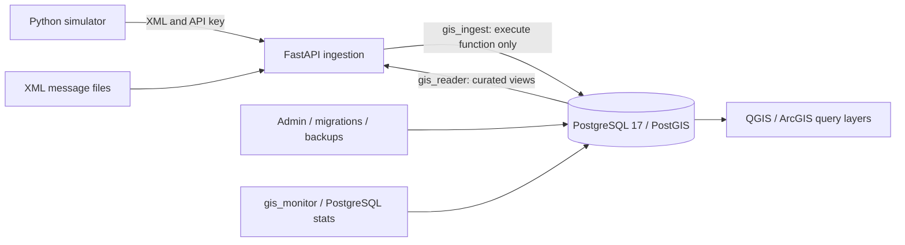

# Architecture and design decisions

Everything is synthetic. Equipment IDs start with `SIM-`. The simulator uses an invented grid around longitude -140, latitude -40 in the South Pacific. These coordinates do not describe actual assets, facilities, units, or movements.

| Relation | Responsibility | Integrity |
| --- | --- | --- |
| units | Fictional group identity | Unique synthetic unit code |
| assets | Equipment identity, type, unit membership | Unique equipment ID; restricted unit deletion |
| telemetry_events | Message identity, observation/receipt time, status, battery, source | UUID PK; asset FK; status and battery constraints |
| locations | One geographic point per accepted event | Event PK/FK; geographic type and coordinate constraints |
| current_state | Pointer to newest event for each asset | Composite FK ensures event belongs to same asset |
| operational_areas | Invented polygon boundaries | SRID 4326 and polygon validity |

Unit names live once in units; asset identity lives once in assets. Event attributes depend on a message ID, rather than being repeated on the asset record. The one-to-one location relation isolates spatial history from event metadata. `current_state` is a maintained pointer for efficient current reads, not a second copy of coordinates or status. The write function inserts the event and location and changes that pointer in one transaction. Restricted roles must use this function; an administrator with table write privileges can bypass application invariants and must avoid doing so.

An exact repeated UUID returns `inserted=false`. Reusing it for different parsed content fails with HTTP 409. Missing equipment fails with 422. Per-asset row locks serialize writers; `(observed_at, message_id)` deterministically picks the current event even when arrivals are out of order or timestamps tie. Location history is retained. UTC timestamps are timezone-aware and stored as `timestamptz`; the receipt timestamp is assigned by the server. Future observations beyond five minutes are rejected, so clock synchronization matters.

WGS 84 SRID 4326 describes longitude/latitude degrees. `geography(Point,4326)` computes distance on the spheroid in **meters**. Polygon boundaries and the QGIS view use `geometry` for GIS compatibility. A geometry distance in 4326 would be degrees, so distance predicates cast current points to geography. `ST_Covers` includes points on polygon edges. Overlapping polygons can produce multiple membership rows.

The history GiST index is on geography, matching `ST_DWithin(position, ..., meters)`. Current queries join a small set of asset pointers; do not assume the history GiST accelerates every cast/view query. Use EXPLAIN on the actual query. B-tree indexes support asset/time histories and FK lookups. Every extra index costs storage, insert CPU, WAL, and vacuum work. Partitioning is intentionally deferred until retention/data-volume measurements justify its operational cost.

The API returns bounded GeoJSON collections, accepts XML up to 16 KiB, requires an API key on data endpoints, and binds all request values as SQL parameters. ElementTree sees only UTF-8 input with DTD/entities prohibited. XML fields are strict, without namespaces, attributes, extra fields, or nesting. Admin credentials never enter the API container. Health endpoints expose only liveness/readiness.

This is a local single-node lab: no message broker, production authentication, automatic failover, TLS termination, or point-in-time recovery is configured. Logical backups demonstrate recovery to the captured snapshot; updates after that snapshot require another backup or a separate WAL/PITR design.

References: [PostGIS ST_DWithin](https://www.postgis.net/docs/manual-3.5/ST_DWithin.html), [Psycopg transaction contexts](https://www.psycopg.org/psycopg3/docs/basic/transactions.html).
